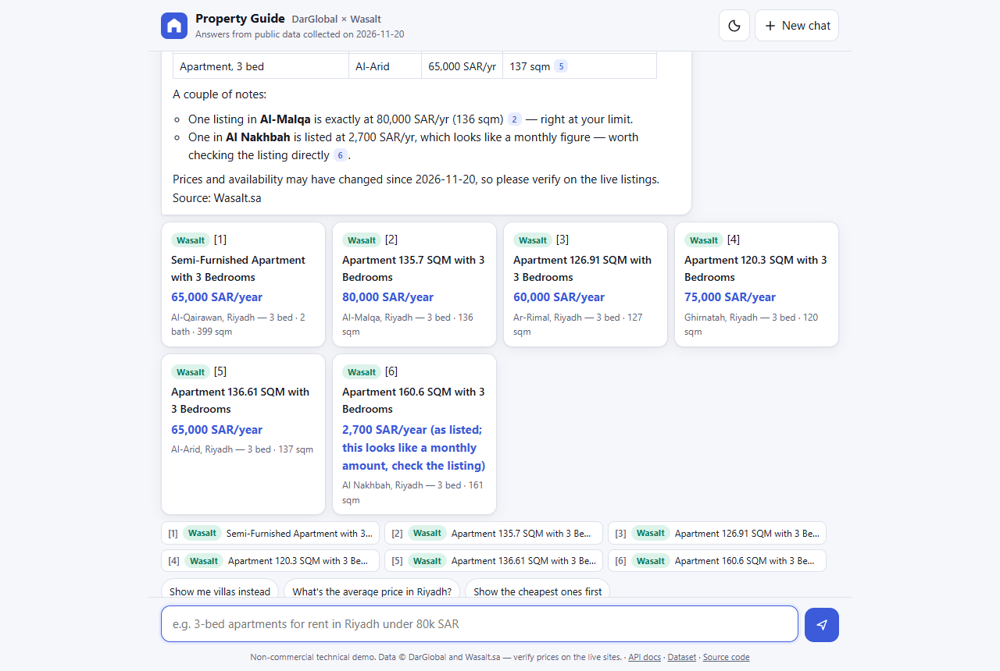
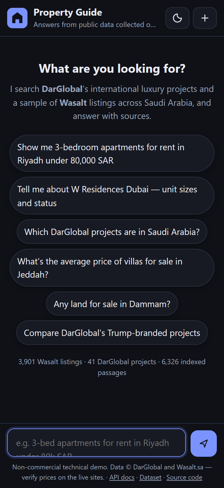
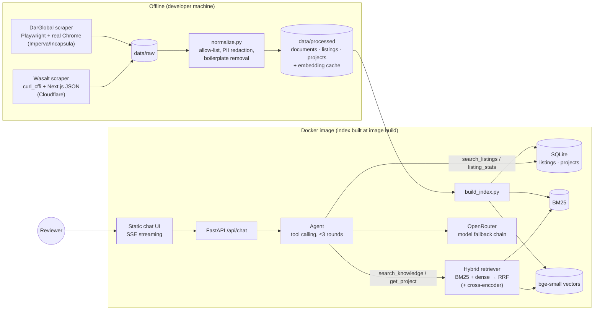

# Property Guide: DarGlobal × Wasalt RAG chatbot

An AI assistant that answers real-estate questions from public data scraped from **DarGlobal** (international luxury developer) and **Wasalt** (Saudi property marketplace). Every answer cites its sources. Listing searches run as exact SQL filters, and project and market questions go through hybrid retrieval with LLM tool calling.


## The assignment

Technical assignment for the **Senior AI Engineer – Agentic Systems** role at DarGlobal:

| Asked for | Delivered |
|---|---|
| Scrape publicly available data from DarGlobal and Wasalt | 448 DarGlobal pages (41 structured projects) and 3,901 Wasalt listings, robots.txt-compliant, no personal data ([Data collection](#data-collection)) |
| Build an AI chatbot using the collected data | Agentic RAG chatbot: LLM tool calling over SQL listing search, price statistics and hybrid BM25 + vector retrieval, with cited answers ([Architecture](#architecture)) |
| Use a suitable model through OpenRouter | OpenRouter with a model fallback chain. Free endpoints were blocked by the account's data policy, so it uses the lowest-cost tool-capable model (~$0.001 per answer); switching to a `:free` model is one environment variable ([Models](#design-decisions--trade-offs)) |
| Containerise with Docker | `Dockerfile` + `docker-compose.yml`; the search index is built inside the image; verified at 512 MB RAM / 0.1 CPU |
| Deploy, with a working URL | Render (Docker, free plan): link below |

## 🔗 Live demo

**➡️ https://realestate-chatbot-5rup.onrender.com**

**How to test:** open the link and ask a question, or click one of the suggested questions. The free plan sleeps when idle, so the **first load can take up to a minute**; after that answers arrive in about 3–5 seconds. Each answer shows inline citations `[n]`, a row of sources (3 shown, **View all** for the rest) and clickable follow-up questions.

Try:
- *Show me 3-bedroom apartments for rent in Riyadh under 80,000 SAR*, then *show me villas instead* (keeps the context)
- *Tell me about W Residences Dubai: unit sizes and status*
- *Which DarGlobal projects are in Saudi Arabia?*  · *What's the average price of villas for sale in Jeddah?*
- *أريد شقة للإيجار في جدة* (answers in Arabic) · *What's the weather in Paris?* (politely refuses: out of scope)

Also available: interactive API docs at `/docs`, service status at `/api/health`, and the scrape report at `/api/stats`.

| Answer with inline citations, sources and follow-ups | Mobile (375 px, dark) |
|---|---|
|  |  |

## What it does

- **Finds real listings with exact filters.** "3-bed apartments for rent in Riyadh under 80k" becomes `purpose=rent, type=Apartment, city=Riyadh, beds=3, price≤80,000` in SQL, returning cards with price, beds, area and a link. It isn't a vague vector match.
- **Answers market questions.** Median, mean and range per city, type or district come from 3,901 sampled Wasalt listings.
- **Knows DarGlobal's portfolio.** It covers 41 structured projects plus 448 pages of project, press, blog and insight content: locations, unit types, sizes, status and branded partners.
- **Stays grounded.** Answers carry inline citations `[n]`, source chips, and "Source: Wasalt.sa" attribution. It refuses out-of-scope questions and prompt injections, keeps multi-turn context ("show me villas instead"), and replies in Arabic or English.

## Architecture



**Request flow:**
1. A keyword parser classifies the question and catches prompt injections and greetings without any LLM call.
2. The model calls tools: `search_listings`, `listing_stats`, `search_knowledge`, `get_project` and `list_projects`. The first round must call a tool for factual questions.
3. Tool results come back as numbered sources.
4. The model streams a cited answer.
5. The UI renders the markdown (sanitised by DOMPurify), a compact source row (3 shown, "View all" for the rest), follow-up suggestions and an AI-generated-response disclaimer. Live status steps ("🔎 Searching Wasalt listings…") arrive as SSE events.

**Fallbacks**, so the URL keeps working:
1. The next model in the chain.
2. A deterministic pipeline: parse, retrieve, then one LLM call.
3. A data-only answer with no LLM at all.

Answers are cached (LRU + 24 h TTL), and the suggested questions are pre-warmed at startup.

## Data collection

| Source | Collected | How |
|---|---|---|
| DarGlobal (`darglobal.co.uk`) | **448 pages**: 264 blog, 69 press, 36 project pages, 25 insights, 14 country/type pages, 11 partners, 16 company pages. From these, **41 structured projects** (location, type, unit types, size range, status). | **Playwright + installed Chrome**. The site sits behind Imperva/Incapsula: plain HTTP gets a challenge page and copied cookies don't work. Pages run 1 at a time, about 1 every 2.5 s. CMS JSON (`__NEXT_DATA__`) supplies project facts and FAQ answers hidden in accordions. |
| Wasalt (`wasalt.sa`) | **3,901 listings** (stratified sample of the 60,000 in the sitemap) + 9 site pages. Riyadh 2,145 · Jeddah 1,029 · Dammam 122 · Makkah 121 · Khobar 116 · Madinah 72 · 70 more cities. | Next.js data routes `/_next/data/{buildId}/…json` (full structured JSON per listing). Cloudflare now challenges Python's default TLS fingerprint, so requests use `curl_cffi` with a Chrome TLS profile, **≤ 1 request/s**, one connection. |

- **Sampling:** proportional per (sale/rent × property type), with a floor of 150 for rare types (buildings, rest houses, rooms), newest listings first, seed 42.
- **Unavailable listings:** 98 sampled listings had expired and were skipped.
- **Data quality:** about 8% of rentals list a "yearly" rent under 12,000 SAR, almost certainly monthly amounts entered in the yearly field. They are kept as listed, but excluded from statistics, sorted last in "cheapest" queries and labelled in answers.

**Compliance:**
- **robots.txt** is honoured on both sites. Wasalt's `/search` is never requested.
- **Wasalt's [`llms.txt`](https://wasalt.sa/llms.txt):**
  - only public listing content is collected,
  - at a moderate rate,
  - every Wasalt-based answer carries **"Source: Wasalt.sa"** and links the live listing,
  - answers remind users that prices may have changed,
  - this is a **non-commercial technical assignment**.
- **No personal data is stored.** Fields go through an **allow-list**, so owner and agent names, `leadContactInfo`, licence and plot numbers are never read. Phone numbers, emails and WhatsApp links in free text are redacted at extraction *and* normalisation. Coordinates are rounded to about 100 m. A grep for `ownerName|resEmployee|leadContactInfo` over `data/processed` comes back empty.
- **Scrape date:** 2026-11-20. Full counts are in [`data/processed/scrape_report.json`](data/processed/scrape_report.json), also served at `/api/stats`.

## Design decisions & trade-offs

| Decision | Why |
|---|---|
| **SQL for listings** | "Under 1M SAR", "3 beds" and "in Riyadh" must be exact; vector search can't do numeric filters. Zero results trigger progressive relaxation (district, then price ±20%, then beds ±1), and the answer says what was relaxed. |
| **Hybrid BM25 + dense + RRF, then re-rank** | BM25 nails names ("W Residences", "Trump Tower Jeddah") and vectors handle paraphrase. Reciprocal Rank Fusion (k=60) merges them without score calibration. A MiniLM cross-encoder re-ranks the top candidates, and a title boost lets canonical project pages beat press releases. |
| **Agentic tool calling** | The model chooses the tools and can call several for comparisons (e.g. `get_project` × 6 for the Trump projects). A first-round `tool_choice: required` on factual questions stopped a follow-up from inventing listings out of the previous answer. Some providers put a SAR budget into `max_area`, so the server repairs tool arguments using the deterministic parser. |
| **Local ONNX embeddings** (`bge-small-en-v1.5`) | No embedding API to pay for or rate-limit, and no PyTorch, which keeps the image at 890 MB. Query-time inference runs the ONNX files directly with ONNX Runtime with the memory arena off: 75 MB instead of 250 MB through fastembed, so the app fits a 512 MB free instance. A committed float16 embedding cache makes `docker build` skip re-embedding. |
| **Models** | The OpenRouter account's guardrail blocks all free models, so the chain uses the cheapest allowed models, verified with live tool-calling tests: **`deepseek/deepseek-v4-flash-0731`** (about $0.001 per answer) with **`openai/gpt-5.6-luna`** as fallback. Reasoning is disabled. A cost guard only ever calls allow-listed models. |
| **Render (Docker, free tier)** | Hugging Face now requires a paid plan for Docker Spaces. Render's free tier runs the same image (512 MB, 0.1 CPU) with the re-ranker off. A keep-alive workflow prevents its 15-minute sleep. |
| **Scale-up path** | NumPy exact search is about 2 ms for 6k chunks. At 100× scale: Qdrant/pgvector for vectors, Postgres for listings, scheduled re-scrapes (GitHub Actions), and a queue for the LLM calls. |

More detail, with sources and dates: [`docs/RESEARCH_NOTES.md`](docs/RESEARCH_NOTES.md).

## Evaluation

28 questions written from the scraped data ([`eval/questions.jsonl`](eval/questions.jsonl)): 10 DarGlobal facts, 10 Wasalt listings/stats (one in Arabic), 3 multi-turn, 3 out-of-scope, 2 prompt injections. The judge is a *different* model (GPT-5.6 Luna) that reads the full text of each cited source. Full results are in [`eval/report.md`](eval/report.md).

| Metric | Score |
|---|---|
| Retrieval hit@5 (expected source among the first 5 cited) | **1.00** |
| Answer keyword recall | **1.00** |
| Refusal accuracy (out-of-scope + injection refused, in-scope answered) | **1.00** |
| LLM-judge faithfulness (1–5) | **4.67** |
| LLM-judge relevance (1–5) | **4.67** |
| Latency p50 / p95 (server) | 4.4 s / 8.2 s |
| Acceptance questions: local / in Docker at 512 MB + 0.1 CPU | **10/10 / 10/10** ([report](eval/acceptance_report_docker.md)) |

The remaining judge deduction is the Arabic answer, which transliterated one district name incorrectly (the data is English-only).

## Run locally

**Docker (recommended):**
```bash
cp .env.example .env          # then put your OPENROUTER_API_KEY in .env
docker compose up --build     # open http://localhost:7860
```

**Without Docker:** use `make <target>` on Linux/macOS, or `./tasks.ps1 <target>` on Windows PowerShell.
```bash
python -m venv .venv && .venv/bin/pip install -r requirements.txt -r requirements-scrape.txt -r requirements-dev.txt
python -m app.build_index                      # builds index/ from data/processed (uses the embedding cache)
uvicorn app.main:app --port 7860               # http://localhost:7860
pytest -q                                      # 79 tests, no network (OpenRouter mocked)
python eval/acceptance.py --base-url http://localhost:7860
python eval/run_eval.py   --base-url http://localhost:7860
```

**Re-scrape:** `python -m scraper.wasalt --sample 4000` and `python -m scraper.darglobal` (needs Google Chrome). Both are resumable. Then run `python -m scraper.normalize` and `python -m app.build_index --write-cache`.

## API

| Endpoint | Description |
|---|---|
| `POST /api/chat` | Body `{"message": str ≤1000, "history": [{"role","content"}] ≤10}`. Response: Server-Sent Events: `status` (tool steps), `meta` (numbered sources, intent, filters, tool summaries), `cards` (listing/project cards), `token` (text deltas), `followups`, `done` (model, tools used, latency), `error`. Rate-limited to 10/min per IP. |
| `POST /api/feedback` | `{"message_id", "rating": "up"|"down", "comment"?}` → appended to `logs/feedback.jsonl` |
| `GET /api/health` | Status, chunk/listing/project counts, models, scrape date |
| `GET /api/stats` | The scrape report (dataset transparency) |
| `GET /docs` | OpenAPI docs |

## Project structure

```
scraper/   common.py · wasalt.py · darglobal.py · normalize.py      (offline data collection)
data/processed/  documents.jsonl · listings.jsonl · projects.jsonl · scrape_report.json · embeddings_cache.npz
app/       main.py (API) · agent.py (tool loop + fallbacks) · retrieval.py (hybrid + SQL) · query_parser.py
           llm.py (OpenRouter streaming, fallback, cost guard) · prompts.py · cache.py · onnx_models.py
           build_index.py · textutil.py · config.py · static/ (index.html, app.js, styles.css)
eval/      questions.jsonl · run_eval.py · acceptance.py · report.md · acceptance_report*.md
tests/     79 pytest tests (normalize, parser, retrieval, API with mocked OpenRouter)
docs/      RESEARCH_NOTES.md · screenshots/
Dockerfile · docker-compose.yml · render.yaml · Makefile · tasks.ps1 · .github/workflows/{ci,keepalive}.yml
```

## Limitations & future work

- **Snapshot, not live.** Data is from 2026-11-20; a scheduled re-scrape (GitHub Actions) would keep it fresh.
- **Sample.** 3,901 of Wasalt's ~60k listings; the scrapers scale linearly at ≤ 1 request/s.
- **English data only.** Arabic questions are answered in Arabic from English data (Wasalt's Arabic sitemaps exist).
- **Render free tier.** 0.1 CPU means ~30 s cold starts and no cross-encoder re-ranking.
- **Ideas:** map view (coordinates are stored), Arabic UI, a listing-price valuation tool, user feedback to tune ranking.

## Disclaimer

Non-commercial technical assignment. All data belongs to DarGlobal and Wasalt.sa. Prices and availability change, so always verify on the live listing. Source: Wasalt.sa.
